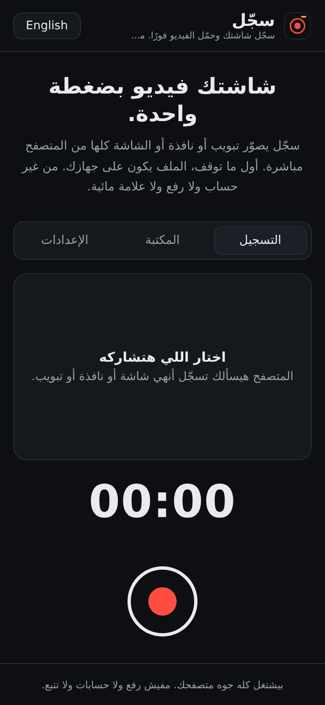
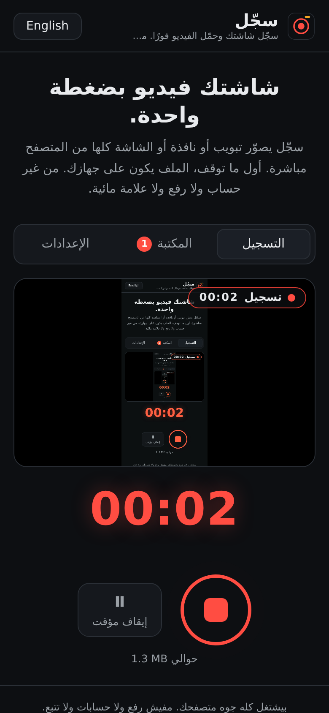
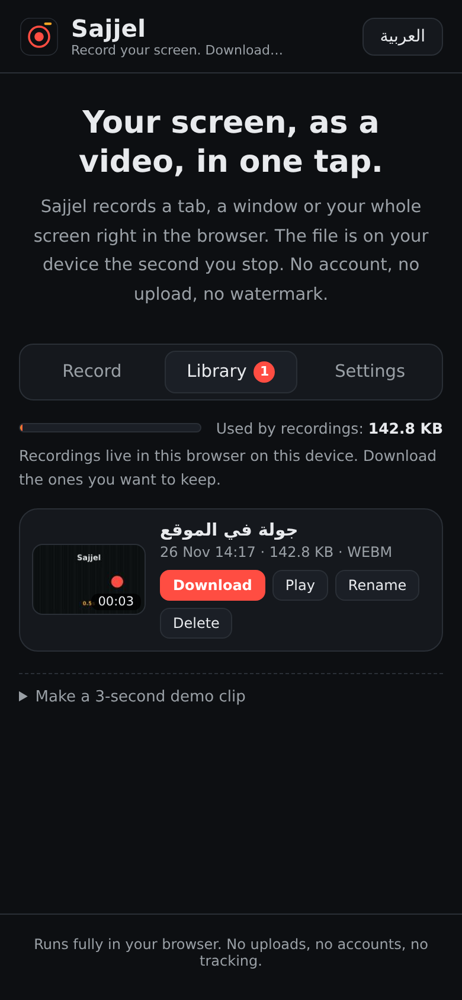
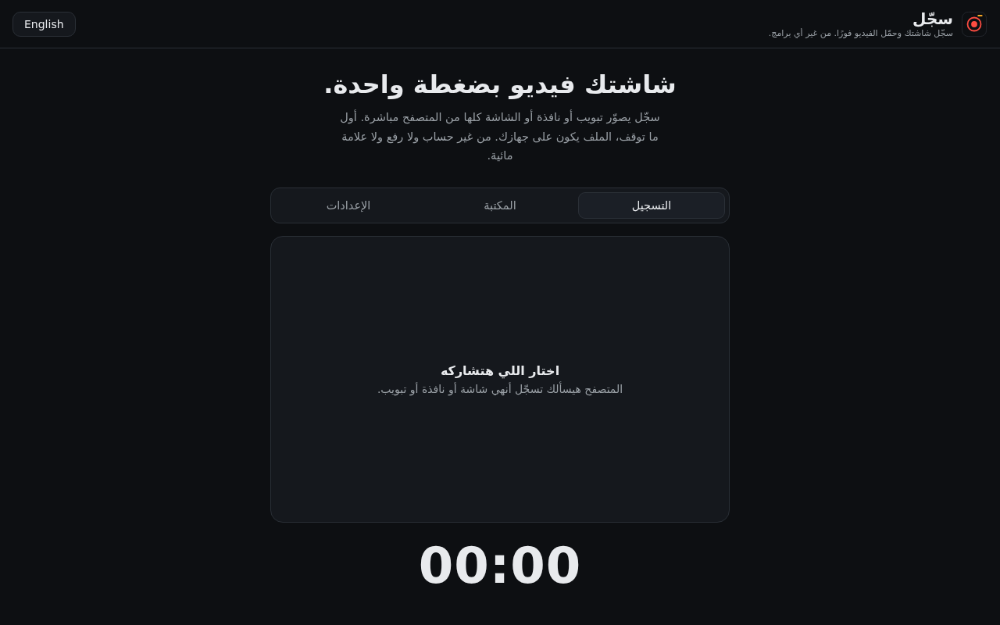
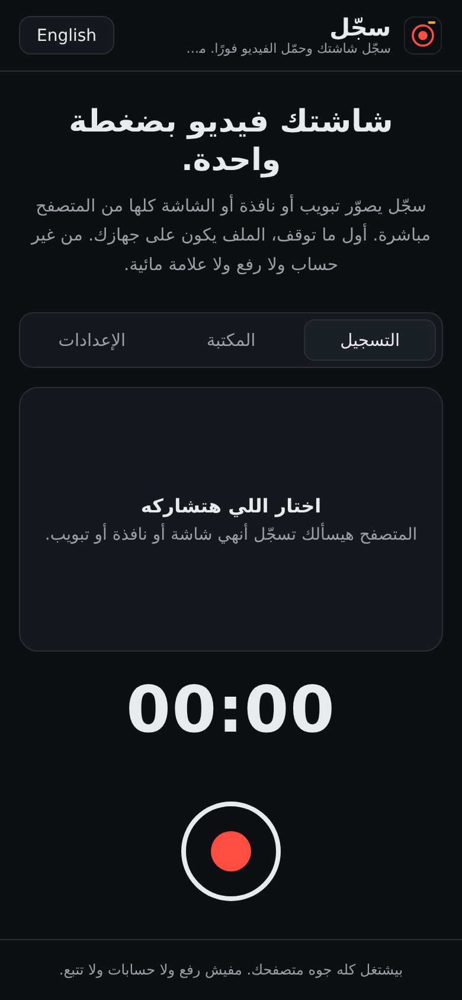

<p align="center"></p>

# Sajjel · سجّل

**Record your screen. Download instantly. Nothing to install.**
سجّل شاشتك وحمّل الفيديو فورًا. من غير أي برامج.

**Live demo:** https://yousefkhames.github.io/sajjel/

Sajjel is a screen recorder that runs entirely in the browser. It uses `getDisplayMedia` and `MediaRecorder` to capture a tab, a window or the whole screen, and the video file is on your device the second you press stop. No account, no upload, no watermark, no server. Arabic (RTL) and English, mobile-first layout.

<p align="center">



</p>

## Screenshots

Captured from the live site (https://yousefkhames.github.io/sajjel/).

<p>
  
  
</p>

## Features

- One-tap screen recording: pick a tab, window or full screen in the browser's own picker.
- Instant download as MP4 or WebM (whichever the browser encodes; MP4 is preferred when supported).
- Pause and resume, with a live timer that freezes honestly while paused.
- Optional microphone narration mixed with the screen's own audio (tab/system audio when the browser allows it).
- Optional 3-second countdown before the capture starts.
- Quality controls: 720p / 1080p / source, 30 or 60 fps, and a data-rate preset with a live file-size estimate while recording.
- A local library: every finished recording is stored in the browser (IndexedDB) with a thumbnail, duration and size. Play, rename, re-download or delete. A storage meter shows how much space recordings use.
- A "demo clip" button that generates a short clip in-page, so the library and downloads can be tried without sharing a screen.
- Arabic and English with full RTL, works offline after the first visit (service worker).

## Tech

Plain HTML, CSS and JavaScript. No framework, no build step, no server, no tracking. Settings live in `localStorage`; recordings live in `IndexedDB` (binary blobs are too large for localStorage). The recording logic that does not touch the DOM (MIME selection, the recorder state machine, the pausable clock, formatters) is a pure module, `recorder-core.js`, shared by the app and the tests.

## Run and test

```
python3 -m http.server 8000   # then open http://localhost:8000
npm test                      # 20 unit tests incl. a 500-walk state-machine fuzz
npm i && npm run e2e          # real Chrome click-through incl. an actual getDisplayMedia recording
```

The e2e script drives headless Chrome through the whole flow: language toggle, settings persistence, a real screen capture with pause/resume/stop, the library, rename, delete and a downloaded file on disk. Set `BASE` to run it against the live URL.

## Honest limits

- Screen recording needs a browser with `getDisplayMedia`: current Chrome, Edge or Firefox on a computer. Most phone browsers (including iOS Safari) do not support it yet; Sajjel detects that and says so instead of failing silently.
- Recordings are stored only in this browser on this device. Clearing site data erases them; download anything you want to keep. Very long recordings can hit the browser's storage quota.
- The container format depends on the browser: Chrome and Edge can produce MP4, Firefox produces WebM. WebM does not play in some older players without conversion.
- System audio is only available when the browser and OS allow it (Chrome on Windows can share system audio; on other platforms it is usually tab audio only).
- GitHub Pages is a free static demo host. All processing happens on your device either way.

## License

MIT
